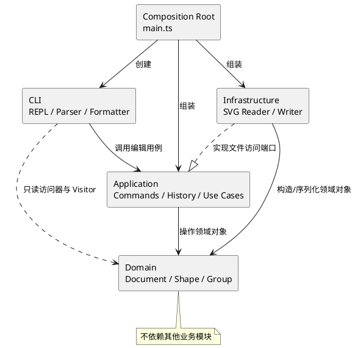

# SVG 编辑器（CLI）

本文档随实现逐阶段更新。当前已完成阶段 7：要求中的 CLI、编辑、历史与 SVG 文件读写已通过完整会话和边界验收。累计 109 项测试通过，详细证据见[测试报告](TEST_REPORT.md)；最终文档一致性审计和发布标签仍留待阶段 8。

启动与快速体验：

```bash
npm ci
npm run cli
```

进入提示符后输入：

```text
init 800 600
create g node
create rect body 10 20 160 60 #4a90d9 in node
create text label 30 55 "开始" in node
tree
move node 0 100
undo
show label
save demo.svg
read demo.svg
help
```

PowerShell 可使用 `npm.cmd run cli`；Windows 在新的一行按 Ctrl+Z 再回车退出，Unix 使用 Ctrl+D。回放示例脚本可在项目目录执行：

```powershell
Get-Content -Encoding UTF8 fixtures/flowchart.commands.txt | node dist/src/main.js
```

回放前先执行 `npm.cmd run build`。Windows PowerShell 5 的管道编码可能不是 UTF-8，若中文乱码，可先设置当前会话 `$OutputEncoding = [System.Text.UTF8Encoding]::new()`；自动化回放测试直接以 UTF-8 输入 Node 进程，不受该管道设置影响。

生成结果示例：[flowchart.svg](../fixtures/flowchart.svg)。它由示例命令实际保存，包含 8 个图形元素，可直接用 Edge/Chrome/Firefox 打开。下面是本次 Edge 无头浏览器渲染的截图：


## 架构方案

### 模块划分

| 模块 | 目录 | 职责 |
|---|---|---|
| 领域层 | `src/domain/` | 保存 SVG 文档、图形类层次、父子关系与领域不变量；不依赖 CLI、文件系统或 XML 库 |
| 应用层 | `src/application/` | 编排编辑用例，实现 Command、undo/redo 与文件访问端口 |
| 基础设施层 | `src/infrastructure/` | 实现 SVG/XML 解析和序列化，以及应用层定义的文件访问端口 |
| 命令行层 | `src/cli/` | 负责 REPL、命令分词与分发、错误映射及 `tree/show/help` 输出 |
| 组合入口 | `src/main.ts` | 创建并连接各模块对象，不承载业务规则 |
| 测试 | `test/` | 保存单元测试、集成测试和典型会话回放测试 |

计划中的组件关系如下：



### 设计模式的选择

1. **Command（强制要求）**：每条编辑命令实现为独立命令对象，封装执行和撤销所需状态。历史管理器只依赖统一的 Command 接口，保证“一条编辑命令 = 一个 undo 单元”。
2. **Composite**：叶子图形与 `Group` 共享统一图形抽象。`move`、`scale`、`set`、`delete` 面向该抽象执行，`Group` 负责递归处理子孙节点。
3. **Factory**：图形工厂根据类型名创建六种内置图形。这是允许的两处按名称分派之一，未来可改为图形提供者注册表。
4. **Command Registry**：命令分发器根据命令名选择处理器。这是另一处允许的按名称分派，未来可改为插件式注册。
5. **Ports and Adapters**：应用层声明 SVG 文件访问端口，基础设施层实现它，使核心逻辑不依赖具体 XML 库和文件系统细节。
6. **Memento**：阶段 4 使用不透明的 `StateMemento` 保存可恢复状态，具体字段由领域对象自己捕获。几何操作直接还原原值，避免浮点逆运算误差；结构操作捕获父子关系和对象引用，恢复时统一重建索引。命令和历史管理器都不读取图形私有字段。
7. **Visitor**：阶段 5 中，六种图形通过 `accept(ShapeVisitor)` 选择 `ShapeFormatter/PositionFormatter` 的具体格式化行为。领域层只定义访问协议，CLI 层实现输出格式，不增加按类型名的条件分派。

阶段 4 的实际落地类如下：

| 类或模块 | 职责 |
|---|---|
| `application/commands/Command` | 统一执行、撤销、重做生命周期；成功后保存前后快照，异常时回滚 |
| `ShapeCommand` | 为 `MoveCommand/ScaleCommand/SetCommand` 捕获目标子树的几何和样式状态 |
| `TreeCommand` | 为 `CreateCommand/DeleteCommand/GroupCommand/UngroupCommand/AddToCommand/BringToFrontCommand/SendToBackCommand` 捕获结构状态 |
| `application/history/CommandHistory` | 管理 undo/redo 栈；仅在命令成功后移动栈；处理 IO 屏障 |
| `application/SvgEditor` | 管理当前文档；拒绝旧文档命令；协调 init、画布修改和历史操作 |
| `domain/memento/StateMemento` | 封装由领域对象提供的恢复行为，不暴露公共状态数据袋 |

结构快照保存整份文档的拓扑、顺序和对象引用，几何快照只保存目标子树的状态。对当前作业规模，这样能够简单、可靠地处理跨父分组和连续撤销，代价是每条结构命令前后各保存 O(n) 引用，长历史占用更多内存；恢复过程需要重建索引，也不是为超大文档优化的实现。若未来有大文档需求，可在保留 Command 接口的前提下改用 `ShapePlacement` 差量收据或持久化树。本阶段选择正确性与可验证性，并记录此项权衡。

图形工厂和命令分发器中的按名称分派均属于已识别的待重构项。本阶段不会实现后续插件化阶段的 `box` 类型。

阶段 6 的 IO 适配结构：

| 类或模块 | 职责 |
|---|---|
| `application/ports/SvgStorage` | 定义读写端口，应用层不依赖文件系统或 XML 库 |
| `SvgReadResult` | 返回已完成校验的文档和缓冲的补 id 警告 |
| `infrastructure/svg/SvgReader` | 使用 DOM 解析 SVG，完整校验、保留层级并自动补 id |
| `SvgWriter/SvgShapeWriter` | 使用 Visitor 构造 XML DOM，处理六种图形和文字/属性转义 |
| `SvgFileStorage` | 实现 UTF-8 文件读取与同目录临时文件替换式保存 |
| `domain/ShapeDefinition` | 在唯一的图形工厂内共享 CLI 和 SVG 的类型定义及几何 schema |
| `ViewBox/SvgAttributes` | 封装坐标系和可保留的展示属性，保持 XML 库细节在基础设施层 |

XML 适配器使用 [xmldom 的 DOMParser/XMLSerializer](https://github.com/xmldom/xmldom)，版本固定为 `@xmldom/xmldom@0.9.12`，并提交 npm 锁文件。文件接口采用同步操作以匹配逐行 CLI；后续如需远程存储，可修改端口和入口为异步，领域模型无需依赖该变化。

### 依赖方向规则

| 调用方 | 允许依赖 | 理由 |
|---|---|---|
| `domain` | 无其他业务模块 | 保持领域规则独立且可测试 |
| `application` | `domain` | 应用层只负责编排领域对象 |
| `infrastructure` | `domain`、`application/ports` | 将 SVG 转换为领域对象并实现应用端口 |
| `cli` | `application`；`domain` 的只读访问器、Visitor 协议、数值解析与错误类型 | 编辑必须调用应用层；显示通过只读 Visitor 读取图形，格式保留在 CLI |
| `main.ts` | 所有模块 | 组合入口实例化具体实现，但不承载业务逻辑 |
| `test` | 被测模块 | 测试可以直接验证各层公开行为 |

禁止领域层引用 Node 文件系统、XML 解析器、REPL 或输出格式；禁止应用层直接打印终端文本；禁止 CLI 调用领域变更方法、导入内部树令牌或直接修改图形字段。CLI 对领域的只读依赖是在阶段 5 明确修订的规则，使显示逻辑无需放入应用层。若后续实现违反规则，应在进入下一阶段前处理，或在修订记录中说明。

### 变化点假设

| 可能变化 | 预留方式或不预留理由 |
|---|---|
| 增加图形类型 | 使用统一图形抽象和集中式图形工厂；Phase 1 只实现六种类型，不提前实现 `box` |
| 增加命令 | 每个命令独立成类并通过注册表接入，避免大型条件分支 |
| 更换 SVG/XML 库 | 解析和序列化限制在基础设施层，通过端口与核心隔离 |
| 增加 GUI 或智能体入口 | 新入口复用应用层用例，不直接修改领域对象 |
| 调整撤销策略 | Command 保存自己的可逆状态，历史管理器不理解具体操作 |
| 修改输出格式 | `tree/show/help` 使用独立格式化组件 |
| 后续插件系统 | 当前只保留清晰的工厂边界，不实现完整插件框架 |

### 规格补充决策

下列原要求未完全规定的边界已在实现中确定并用测试固定：

- 外部文件含重复 id 时，整个 read 失败，报 `id already exists: <id>`；先预留全部显式 id，再补缺失 id，避免与后出现的元素冲突。
- 无参数 save 使用最近一次成功 read/save 的路径；init 清除记忆路径；无路径时提示 `no file path. use 'save <file.svg>' first`。失败操作不更新路径。
- 数值接受有限十进制、浮点和科学计数法；SVG 数值可带 px 后缀；宽高/半径非负、画布和 viewBox 尺寸为正。
- 导入保留宽高、viewBox、全局和元素级样式及字体/文本对齐等被动展示属性；后者不扩大 `set` 命令白名单。canvas 修改尺寸后，viewBox 重置为 `0 0 w h`。
- 外部 SVG 限于六种图形和已支持的展示属性；未知元素、未知属性、transform、内嵌 tspan、CSS style/class、百分比/非 px 单位会明确报错，避免静默丢弃或错误变换。后续若扩展支持，应先定义编辑语义再增加测试。
- 输入文件使用 UTF-8；无效字节直接读入失败。支持 XML 声明、命名空间前缀、注释、CDATA 和字符实体；不支持 DOCTYPE 与其他处理指令。注释不参与可编辑文档，保存时不保留注释。

已经明确：`canvas` 无参数查询不会阻断 undo；任何失败操作必须保持文档、id 索引和历史栈不变；不支持的输入不会被静默丢弃。空的 `g` 图形合法，但 `group <newGid>` 必须至少指定一个现有图形。跨父容器分组按操作前的深度优先文档顺序排列目标，新 Group 放在最早目标的原父容器和原索引；若同时选择祖先和后代则整体拒绝。`front` 移到同级数组末尾，`back` 移到开头，以符合 SVG 后绘制元素显示在前面的规则。

## 过程记录

### 阶段 1：工程骨架

- 检查要求和工作区后，确认目录中只有要求文档，没有代码模板，也尚未建立 Git 仓库。
- 将任务识别为“架构与过程同样重要的 CLI 应用”，因此没有一次生成全部功能，而是拆成可验证阶段。
- 明确由 AI 协作者负责代码、测试和文档修改，由项目所有者独立完成所有 Git 提交、标签与推送。
- 初始方案隔离领域模型、Command 历史、SVG IO 和 CLI，避免形成上帝类。
- 阶段 1 只实现启动骨架和冒烟测试，不把尚未完成的命令描述为已实现。

后续阶段将记录有代表性的 AI 建议、发现的问题、验证方法和实际修正，不把未经验证的生成结果直接作为完成依据。

### 阶段 2：领域模型与 Composite

- 为六种内置图形分别建立类，几何字段保持私有，只通过行为方法和只读访问器暴露；没有使用按图形类型分派的 `switch`。
- `Shape` 以模板方法统一 `move`、`scale`、公共样式和属性访问，具体图形通过多态实现各自几何规则。
- `Group` 与叶子共享 `Shape` 抽象，并递归移动、缩放和遍历子孙。Composite 操作先完整验证再修改，避免后代溢出时只修改了前半棵树。
- `SvgDocument` 作为聚合根维护画布、根节点和全局 id 索引；明确 id 大小写敏感，宽高与半径允许为零但不能为负，坐标允许为负，画布尺寸与缩放因子必须为正。
- 首轮实现后发现：若调用方直接向已经挂入文档的 `Group` 添加子节点，文档索引可能不同步。修正方案是让每个图形记录文档归属，由附着的 Group 在插入前调用文档验证、插入后统一注册子树，并增加回归测试。
- Group 的 `fill/stroke/stroke-width` 保存在 Group 自身，不擅自覆盖子节点显式样式；实际继承效果由 SVG 渲染语义决定。
- 本阶段没有提前实现 CLI 命令、Command 历史、SVG IO 或 `box`。

### 阶段 3：树结构编辑

- 在 `SvgDocument` 聚合根中实现 `delete`、`group`、`ungroup`、`addto`、`front` 和 `back` 的领域语义；应用层不需要直接拼装父子指针或 id 索引。
- `delete` 注销整棵子树，但保留被删 Group 内部的父子关系；同时返回不可变的 `ShapePlacement`，能够按原父容器和原索引精确恢复。聚合根也提供受校验的 `moveShapeTo`，可将仍在文档中的图形恢复到保存位置，为下一阶段 Command 撤销做准备。
- `group` 支持同父和跨父收编，按操作前的文档顺序保持目标相对次序；所有 id、重复参数和祖先/后代关系均在修改前验证。
- `ungroup` 将直接子节点连续提升到原 Group 位置，保持顺序；严格拒绝顶层 Group，并只注销被解散容器自身。
- `addto` 将已有子树移动到目标 Group 末尾，并拒绝把容器放入自身或后代；`front/back` 只调整同级顺序，不改变归属关系。
- 为 Group 的底层摘除/插入原语增加内部变更令牌，避免应用代码绕过 `SvgDocument` 破坏聚合一致性。
- 审查中明确了跨父分组的规格空白，并将选定规则同时写入文档和自动化测试，而不是依赖未记录的实现偶然行为。

### 阶段 4：Command 与 undo/redo

- 为全部十种编辑操作建立独立命令类，通过统一 Command 基类和两个多态中间类接入历史，未新增按图形名称分派。
- 评估反向 `move(-dx,-dy)` 和 `scale(1/factor)` 后，发现它们无法可靠还原浮点数：大数相加会丢失低位，小因子缩放可能下溢为零。改由图形封装精确的前后快照，并用负零、大数和最小正数回归测试验证。
- 评估仅按原索引逐个恢复分组后，选择完整拓扑快照处理多父容器、间隔选择和对象身份；根级分组撤销不依赖被规格禁止的顶层 `ungroup`。
- `CommandHistory` 在执行、撤销或重做成功后才更新栈。失败编辑保留 redo；成功的新编辑清空 redo；一条命令只占一个撤销单元，包括稳定的 no-op 编辑。
- 成功的 init、文档替换、画布尺寸修改或 `markIoBoundary()` 清空历史并禁止 undo/redo，直到下一次成功编辑；查询和失败操作不改变屏障。后续 read/save 会在实际 IO 成功后接入该边界，本阶段尚未实现文件访问。
- 通过故障注入命令在添加并分组后主动抛出异常，确认文档和历史仍完整回滚；通过外部文档归属冲突验证失败的 undo/redo 保留栈项。
- 一条包含 15 次混合编辑的用例逐步撤销到空文档、再逐步重做，每一步都检查结构、属性、父指针、索引和计数。
- 从阶段 3 起，项目所有者授权 AI 完成经过验证的阶段提交和远程推送，提交说明使用中文；每阶段结束仍停下来确认下一阶段。

### 阶段 5：CLI、显示与会话回放

- `Tokenizer` 逐字符解析双引号、转义引号和反斜杠，保留空文本和中文；只有整行第一个非空白字符为 `#` 时才忽略该行，不会截断 `#ffffff` 颜色。
- `CommandDispatcher` 将命令名映射到处理方法，所有编辑通过应用层 Command 执行。`ShapeFactory` 是唯一的图形类型名映射，集中创建六种图形，拒绝 `box`；两处名称分派继续列为待重构边界。
- 创建命令在尾部解析 `in <containerId>`，包括 `create g ... in ...`；文字中的 `in` 保持文本内容。参数数量和数值先验证，错误统一转为一行 `error:` 输出。
- 为图形增加只读 Visitor 协议和统一的 `children` 访问器；CLI 格式化器通过多态读取几何数据，生成树枝、内联属性、样式和父容器信息。
- 初始依赖规则只允许 CLI 引用 application。实现显示时，为避免把终端格式写进应用层，明确修订为“CLI 可读取领域公开访问器/Visitor，编辑仍只能调用应用层”，并同步修改组件图和依赖表。
- `CommandFeedback` 将编辑与历史反馈保留在 CLI，并使用 WeakMap 关联 Command；undo/redo 重新读取恢复后的图形状态，不污染领域或历史管理器。
- `Repl.run()` 使用 readline 逐行处理输入，错误后继续接收命令，支持 CRLF、stdin 脚本和 EOF 退出；保留 `start()` 的启动显示接口。
- 新增 `fixtures/flowchart.commands.txt`，使用真实子进程回放要求第 6.1 节的手工组合流程图。暂不加入 save；文件 IO 的成功/失败和持久化留到阶段 6 验证。

### 阶段 6：SVG 文件读写

- 将文件接口定义在 application/ports，并在 main.ts 显式注入 `SvgFileStorage`；CLI 和应用层都没有导入文件系统或 XML 库。
- 读取先严格解析 XML、检查全局重复 id、分配缺失 id、构建完整新文档，全部成功后才替换旧文档、更新路径并清空历史；失败不会输出预先缓冲的 warning。
- 保存先完成 XML DOM 序列化，再创建同目录随机临时文件。文件描述符在 finally 中关闭，成功后 rename 到目标；错误时删除本次临时文件，原目标和编辑历史保持不变。
- SVG 序列化复用 Visitor，类型创建复用唯一的 ShapeFactory；为共享 SVG 几何 schema 引入 `ShapeDefinition`，没有新增第三处按图形名分派。
- 编解码测试发现 XML 库把声明 `<?xml ...?>` 表示为处理指令，直接对整份 DOM 进行严格重新序列化会误拒绝合法 XML 声明。调整为先检查顶层节点，再严格校验实际根子树；用作业原始样例和保存读回用例确认修正。
- 显式处理文字中的 CR 和属性中的空白实体，避免 XML 规范化导致读回内容变化；省略的 fill/stroke 仍保持未设置。
- 增加 root viewBox 与被动展示属性的领域值对象，保留外部文件的坐标系、字体和继承样式；不声称支持任意 SVG，对不支持的变换和结构明确拒绝。
- 完整回放要求第 6 节的 save/read 流程，并用真实 Node 子进程生成、读回两节点流程图；另在 Edge 无头浏览器打开生成文件，检查矩形、连线和中文文字均正常。

### 阶段 7：完整验收与边界测试

- 新增独立验收入口 `npm run test:acceptance` 和内置 V8 覆盖率入口 `npm run test:coverage`。
- 把作业第 6 节完整会话拆成命令与预期输出 fixture，使用真实进程在临时目录执行，逐行比较反馈、错误、warning 和树，并检查生成的 SVG 内容。
- 回归测试确认两项缺陷：`set` 接受十六进制导致数值规则不一致；`show` 没有显示已导入的被动展示属性。分别通过共享 `FiniteNumber` 和补齐格式化器修复，未扩大 set 白名单。
- 增加所有图形的几何/公共属性白名单矩阵、溢出原子性、大小写敏感、特殊文本和 EOF 边界。
- 4 个固定种子生成 640 条混合输入，519 次成功编辑均逐条撤销/重做，121 次拒绝输入均验证树与历史不变；同时检查全局 id、对象身份、父指针和序列化回环。
- 使用 `npm ci` 从锁文件重装依赖，再次执行完整覆盖率测试，确认可复现；实际结果和未覆盖范围如实记录在 `doc/TEST_REPORT.md`。

## 一致性自查

### 模块划分

阶段 1 建立骨架；阶段 2/3 加入领域模型与树结构；阶段 4 加入应用层和 Memento；阶段 5 加入 CLI、工厂、Visitor 与 fixtures；阶段 6 加入计划中的 `infrastructure/svg/` 和 `application/ports/`。`ViewBox/SvgAttributes/ShapeDefinition` 是 IO 阶段的已记录细化。所有类独立成文件，文件名与类名一致。

### 依赖方向

领域层只依赖自身类型；应用层只依赖领域对象和自身端口；基础设施层实现应用端口并构造/读取领域对象；CLI 负责 readline、命令语法和输出。main.ts 负责把具体存储注入应用层。XML 库与 fs 仅由基础设施层引用；未出现跨层逆向依赖或 CLI 直接修改领域数据。

## 质量保证手段

项目采用以下验证层次：

1. TypeScript 严格模式编译，并启用大小写一致性、未检查索引和可选属性检查；
2. 领域单元测试验证几何操作、属性白名单和树结构不变量；
3. Command 测试验证执行、失败原子性、undo/redo 和 IO 历史屏障；
4. SVG round-trip 测试验证嵌套层级、顺序、文字转义、浮点数和自动 id；
5. CLI 集成测试回放要求中的完整 transcript，并比较稳定输出；
6. 手动用浏览器打开保存的 SVG，确认文件可以真实渲染。

阶段 7 的完整[验收报告](TEST_REPORT.md)列出了需求矩阵、复现命令、已发现问题及修复、固定种子测试和实际覆盖率；不要只根据“测试通过”判断功能完整性。

阶段 1 的质量门槛为：

```bash
npm run build
npm test
npm run cli
```

当前冒烟测试验证 CLI 骨架输出应用名称和 `svg>` 提示符。每阶段完成后都会运行全部已有测试，避免后续功能破坏之前行为。

### 阶段 1 验证记录

验证日期：2026-10-29。

- `npm.cmd run build`：通过，TypeScript 严格模式编译无错误；
- `npm.cmd test`：通过，1 项测试全部成功，0 项失败；
- `npm.cmd run cli`：通过，输出应用横幅和 `svg>` 提示符；
- `npm install`：审计 5 个包，未发现已知漏洞；
- 当前验证环境为 Node.js 24.19.0、npm 11.17.0、TypeScript 7.0.2。

由于本机 PowerShell 执行策略会拦截 `npm.ps1`，本次验证使用功能等价的 `npm.cmd`。项目脚本本身不依赖这一环境差异，其他终端仍可正常使用 `npm`。

### 阶段 2 验证记录

验证日期：2026-10-29。

- `npm.cmd run build`：通过，严格模式编译无错误；
- `npm.cmd test`：通过，22 项测试全部成功，0 项失败；
- 覆盖范围包括六种叶子图形的几何行为、属性白名单、Composite 递归操作、变换失败原子性、父子关系、稳定遍历顺序、全局 id 唯一性、大小写敏感和文档索引同步；
- 保留阶段 1 的 CLI 冒烟测试，确认新增领域模型没有破坏启动骨架。

### 阶段 3 验证记录

验证日期：2026-10-29。

- `npm.cmd run build`：通过，严格模式编译无错误；
- `npm.cmd test`：通过，34 项测试全部成功，0 项失败；
- 新增验证覆盖根级和嵌套删除/恢复、同父和跨父分组、祖先/后代冲突、嵌套解组、顶层解组拒绝、addto 防环、根级与组内 z-order；
- 每个错误场景都比较操作前后的公开树快照，确认根顺序、父指针、文档归属、id 索引和元素计数均未改变；另验证保存的位置可以精确撤销 addto、z-order 和根级分组结构。

### 阶段 4 验证记录

验证日期：2026-10-30。

- `npm.cmd test`：通过，54 项测试全部成功，0 项失败；该命令同时执行严格模式构建；
- 新增 20 项测试，覆盖全部十种命令的 undo/redo、跨父分组、空组、浮点精度、未设置样式、IO 屏障、失败回滚、旧文档隔离和连续混合操作；
- `npm.cmd run cli`：通过，提示骨架可以正常启动；
- 检查领域层与应用层 import，未出现逆向跨层依赖、终端打印或按图形类型分派。

### 阶段 5 验证记录

验证日期：2026-10-30。

- `npm.cmd test`：通过，70 项测试全部成功，0 项失败；同时通过 TypeScript 严格模式构建；
- 新增 16 项测试，覆盖分词、六种工厂类型、引号与 Windows 路径、树格式、所有编辑命令反馈、非法输入原子性、显示命令跳过历史和 IO 屏障；
- 真实 Node 子进程读取流程图脚本并退出，stdout 包含预期层级、中文和 undo 摘要，stderr 为空，退出码为 0；
- 流式 REPL 测试覆盖 CRLF、注释和错误后继续执行；
- `read/save` 当前明确返回“阶段 6 实现”，失败不阻断已有 undo/redo，测试中单独验证此阶段边界。

### 阶段 6 验证记录

验证日期：2026-10-30。

- `npm.cmd test`：通过，91 项测试全部成功，0 项失败，包含严格模式构建；新增 21 项 SVG 编解码与真实文件测试。
- round-trip 覆盖六种图形、嵌套顺序、id、浮点、viewBox、展示属性、中文/emoji、实体、CDATA、空内容、CR/换行及省略样式。
- 文件测试覆盖中文与空格路径、无参数 save、init 重置路径、补 id 警告、重复 id、损坏 XML、无效 UTF-8、缺失文件、不可写目标、序列化失败和临时文件清理；均检查失败后文档/路径/历史保持。
- 真实子进程完成两节点流程图的 save→init→read，生成并重新读回 8 个元素；完整作业 transcript 的 save/read 部分也已自动验证。
- Edge 无头浏览器实际打开 `fixtures/flowchart.svg`，已目视检查 PNG，矩形、连线和中文文字正常，预览截图保存于 `doc/assets/flowchart-preview.png`。
- npm 安装审计 6 个包，报告 0 个已知漏洞。

### 阶段 7 验证记录

验证日期：2026-10-30。

- `npm.cmd run test:acceptance`：18 项验收测试通过；
- `npm.cmd ci`：依赖重装成功，审计 6 个包，0 个已知漏洞；
- 重装后 `npm.cmd run test:coverage`：严格模式构建通过，109 项完整测试通过、0 项失败或跳过；
- V8 生产代码覆盖率：行 96.83%、分支 94.43%、函数 99.30%；统计对象为编译后的 `dist/src/**`；
- 完整会话逐行比对、640 条固定种子混合输入及 1038 次全量撤销/重做状态检查均通过；
- 详细结果及实际限制见[测试报告](TEST_REPORT.md)。
